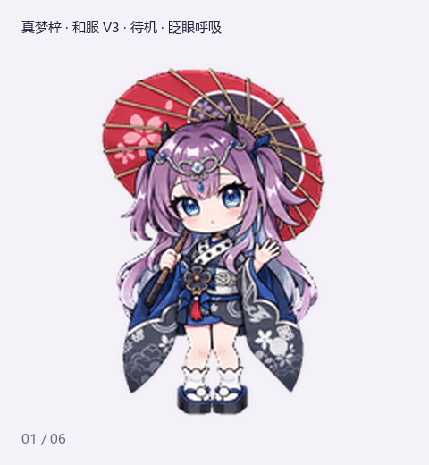

# 真梦梓 · Q 版桌宠 V3

## 已知交互限制

在本次核对的 Windows 版本中，普通鼠标移动和拖拽不会驱动 16 向视线跟随。**素材齐全不等于运行时已支持鼠标跟随**；具体版本、适用范围和检查结果见 [已知限制说明](KNOWN_LIMITATIONS.md)。

## 移植到其他 Agent

图片素材完整。另提供 **219 张独立透明 PNG**，无需重新绘制或手动拆图：

- [下载逐帧 PNG 包](portable-frames.zip)（在文件页点 **Download raw file**，或下载整个仓库后解压）。
- [DeepSeek Harness / Claude Code 移植说明](PORTING.md)。
- [动作坐标与逐帧时长](animation-map.json) · [无损导出工具](export_frames.py)。

每套 57 个动作帧 + 16 个视线帧，单帧透明画布 192 × 208。素材和工具可独立使用；宿主仍需接入自己的事件与播放器。本包未宣称已安装或实测完整 DeepSeek Harness / Claude Code 插件。

真梦梓的通行证、常服（羁绊）、和服三套桌宠成品，沿用已确认的日系 Q 版画风。每套包含 **9 类标准动作、16 向环视，共 73 帧**。

| 通行证 V3 | 常服（羁绊）V3 | 和服 V3 |
| --- | --- | --- |
|  |  |  |

## 三套造型

- **真梦梓 · 通行证 V3**：黑金羽饰短礼裙、蓝玫瑰、白色连裤袜和冰鞋；移动采用冰上滑行。
- **真梦梓 · 常服（羁绊）V3**：灰色泡袖上衣、金色花饰、蓝缎带和紫色**短裙**；各动作保持连续裙摆。
- **真梦梓 · 和服 V3**：灰蓝花纹短和服、银蓝腰带、白袜木屐和红色和伞；跳跃时去掉伞，工作与复查分别整理腰带、检查袖口。

## 下载与使用

| 造型 | 最终精灵表 | 完整视频 | 环视预览 |
| --- | --- | --- | --- |
| 通行证 | [PNG](pets__pass-v3__spritesheet.png) | [MP4](pets__pass-v3__all-actions.mp4) | [GIF](pets__pass-v3__look-loop.gif) |
| 常服（羁绊） | [PNG](pets__casual-v3__spritesheet.png) | [MP4](pets__casual-v3__all-actions.mp4) | [GIF](pets__casual-v3__look-loop.gif) |
| 和服 | [PNG](pets__kimono-v3__spritesheet.png) | [MP4](pets__kimono-v3__all-actions.mp4) | [GIF](pets__kimono-v3__look-loop.gif) |

可打开 GIF 或 MP4 查看动画；加载桌宠时使用对应的精灵表 PNG，需要支持下述规格的桌宠宿主。

## 文件命名与样图

所有文件均平铺在仓库根目录。原路径中的 `/` 替换为 `__`，例如 `pets/pass-v3/spritesheet.png` 对应 `pets__pass-v3__spritesheet.png`。三套文件分别采用 `pets__pass-v3__`、`pets__casual-v3__`、`pets__kimono-v3__` 前缀。

- `states__动作名.gif` 后缀：9 类动作的独立循环。
- `idle-jump-idle.gif` 后缀：待机、跳跃、落地的衔接预览。
- `contact-sheet.png` / `direction-sheet.png` 后缀：动作帧和方向总览。
- `still-01.png` 至 `still-04.png` 后缀：带时间标记的静帧。
- `timeline.json` 后缀：完整标准动作预览的帧时间线。

批准样图：[三套总览](previews__三套V3样图总览.png) · [通行证](previews__通行证-V3-样图.png) · [常服（羁绊）](previews__常服羁绊-V3-样图.png) · [和服](previews__和服-V3-样图.png)。

## 图集规格

作品名中的 **V3** 是本次制作版本；精灵表采用 **Pets v2** 格式：透明 PNG，1536 × 2288 像素，8 列 × 11 行，每格 192 × 208 像素。

前 9 行依次为待机、向右移动、向左移动、招手、跳跃、失落、等待回应、工作／思考、复查；有效帧数为 6、8、8、4、5、8、6、6、6。最后两行包含 16 个方向，从向上看开始，按屏幕方向顺时针每 22.5° 排列；90° 向右、180° 向下、270° 向左。

[manifest.json](manifest.json) 记录当前文件名、原相对路径、规格和 SHA-256；可用于校验成品或恢复原来的目录结构。
